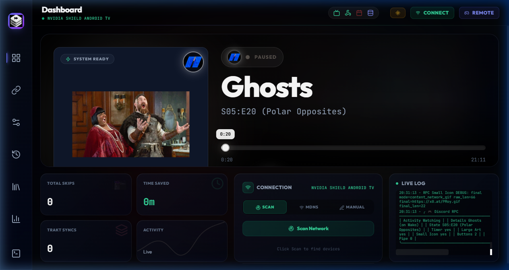

# Ascend Media RPC

> A cinematic control center for broadcasting live Android TV playback to Discord Rich Presence.

Ascend Media RPC watches Android TV, Stremio-compatible clients, Wako, or Stremio Desktop, resolves metadata and artwork, and publishes a truthful live presence through Discord IPC/arRPC clients such as Audiocord.

It is built for long-running personal use: resilient ADB reconnects, stable pause/resume timestamps, fast seek handling, privacy-first configuration, animated network icons, and a local dashboard for the entire pipeline.

## Highlights

- Live MediaSession playback projection while video controls are hidden.
- Correct pause, resume, seek-to-zero, and rapid forward/backward seek behavior.
- Episode-aware Discord Rich Presence with elapsed and remaining time.
- Audiocord/arRPC and Discord IPC support through the local discord-ipc pipe family.
- Large artwork fallback: Top Posters, Better Posters, ERDB, TMDB, then safe fallback.
- Small icon fallback: original network, streaming service, studio, genre, actor, logo, poster, app.
- Verified animated network GIF resolution with invalid-response rejection.
- Skip orchestration, caching, history, analytics, health telemetry, audit logs, and a deep ADB mapper.
- Local-first security boundaries: runtime secrets and device settings stay outside Git.

## Dashboard

| Surface | Purpose |
| --- | --- |
| Dashboard | Now playing, poster, episode metadata, live progress, controls, skip state, and health |
| Connections | TMDB, Trakt, Discord RPC, artwork, Nuvio, and skip sources |
| Preferences | Artwork order, GIF behavior, timestamp display, Wako, privacy, theme, and devices |
| History | Searchable skip and playback history |
| My Lists | Local list browsing and metadata detail views |
| Analytics | Watch time, sessions, genres, streaks, peak hours, and skip statistics |
| Debug | Console output, audit records, caches, health, exports, and plugins |

The UI uses a dark ethereal glass-and-aurora system with a light mode, responsive navigation, reduced-motion support, and real controls wired to the backend.

## Architecture

~~~text
Android TV / Stremio / Wako / Desktop
                 │
                 ▼
       ADB + MediaSession readers
                 │
                 ▼
       Playback controller + timeline
          ├── metadata identity
          ├── skip orchestration
          ├── artwork fallback chain
          └── network GIF selection
                 │
          ┌──────┴──────┐
          ▼             ▼
   Local Flask UI   Discord IPC / arRPC
                         │
                         ▼
                Discord / Audiocord
~~~

The application is local-first. config.json, credentials, device addresses, logs, ADB keys, caches, mapper output, and installer archives remain outside the public repository.

## Requirements

- Windows 10/11 is the primary supported platform.
- Python 3.10 or newer.
- Android TV with ADB debugging for TV playback detection.
- A Discord IPC/arRPC client for presence display.
- Network access to enabled metadata and artwork providers.
- Optional provider credentials for TMDB, Top Posters, ERDB, Trakt, Nuvio, AniSkip, or IntroDB.

The RPC can run while the TV is offline; it starts the dashboard and reconnects when the device returns.

## Setup

Clone and create the environment:

~~~powershell
git clone https://github.com/Cxsmo-ai/Ascend-Media-RPC.git
cd Ascend-Media-RPC
.\setup_env.bat
~~~

Manual alternative:

~~~powershell
py -3 -m venv venv
.\venv\Scripts\Activate.ps1
python -m pip install --upgrade pip
python -m pip install -r requirements.txt
~~~

Create private runtime configuration:

~~~powershell
Copy-Item config.example.json config.json
~~~

Safe starting values:

~~~json
{
  "adb_host": "ANDROID_TV_IP",
  "adb_port": 5555,
  "dashboard_bind_host": "127.0.0.1",
  "dashboard_port": 5466,
  "discord_client_id": "",
  "top_posters_api_key": "",
  "erdb_token": "",
  "nuvio_covers_email": "",
  "nuvio_covers_password": ""
}
~~~

Start the app:

~~~powershell
.\run.bat
~~~

Direct launch:

~~~powershell
.\venv\Scripts\python.exe start_gui.py
~~~

Headless/browser mode:

~~~powershell
.\venv\Scripts\python.exe start_gui.py --headless
~~~

Open http://127.0.0.1:5466.

## Android TV

Enable Developer Options and USB or wireless debugging, then set the device address locally:

~~~powershell
$env:ASCEND_ADB_HOST = "ANDROID_TV_IP"
.\run.bat
~~~

One-launch override:

~~~powershell
.\venv\Scripts\python.exe start_gui.py --host ANDROID_TV_IP
~~~

Quick launcher:

~~~powershell
$env:ASCEND_TV_HOST = "ANDROID_TV_IP"
.\Quick Start RPC.bat
~~~

The controller uses TCP ADB through adb-shell; a standalone adb.exe installation is not required.

Connection checklist:

1. TV and computer share a network.
2. ADB debugging is enabled.
3. The TV accepted the debugging authorization.
4. The configured host and port are reachable.
5. A target playback app is active.
6. Discord, Audiocord, or arRPC is running locally.

## Playback and timestamps

The controller prefers Android MediaSession state and projects position from the device elapsed-realtime clock.

This gives you:

- progress while controls are hidden;
- pause that freezes instead of drifting;
- resume re-anchored from the exact paused position;
- immediate adoption of fast forward and backward seeks;
- correct seek-to-zero handling;
- stale-sample protection;
- anchor reset when the title changes;
- UI XML only as a metadata fallback.

The dashboard and Discord payload share the same timeline anchors.

## Artwork

Default large-image priority:

~~~text
Top Posters → Better Posters → ERDB → TMDB → safe static fallback
~~~

Set large image mode to episode for episode presence:

~~~json
{
  "artwork_provider": "top_posters",
  "artwork_fallback_chain": ["top_posters", "better_posters", "erdb", "tmdb"],
  "rpc_large_image_mode": "episode",
  "top_posters_enabled": true,
  "better_posters_enabled": true,
  "erdb_posters_enabled": true
}
~~~

Provider credentials are never inserted into public URLs or sent through public resizing proxies.

## Animated network icons

Selection is explicit:

~~~text
1. Original broadcast network
2. Streaming provider
3. Production studio
4. Genre
5. Main actor
6. Static network logo
7. Poster
8. App icon
~~~

The static fallback library lives under src/web/static/network_gifs/. Animated assets are verified before being sent to Discord; invalid, deleted, HTML challenge, and non-image responses are rejected.

~~~json
{
  "network_gifs_enabled": true,
  "network_gifs_validate_urls": true,
  "rpc_small_icon_mode": "content_network_gif",
  "rpc_small_icon_tv_chain": [
    "network_gif", "streaming_gif", "studio_gif", "genre_gif",
    "actor_gif", "network_logo", "poster", "app"
  ]
}
~~~

## Nuvio collections

Keep Nuvio settings only in local config.json or environment variables:

~~~json
{
  "nuvio_covers_enabled": true,
  "nuvio_covers_base_url": "https://nuvio.tv",
  "nuvio_covers_email": "",
  "nuvio_covers_password": "",
  "nuvio_covers_token": "",
  "nuvio_anon_key": ""
}
~~~

For local environment configuration:

~~~powershell
$env:NUVIO_ANON_KEY = "LOCAL_ONLY_VALUE"
~~~

Never paste provider credentials into issues, screenshots, logs, README files, or public URLs.

## Discord and Audiocord

Ascend Media RPC sends Rich Presence over local Discord IPC pipes. Audiocord/arRPC clients are supported when their IPC bridge is available.

If the dashboard is healthy but another Discord surface is not:

1. Confirm both surfaces use the same Discord account.
2. Confirm activity visibility and privacy settings.
3. Confirm the client supports external Rich Presence.
4. Restart Discord or arRPC after changing its bridge.
5. Check the Debug view for pipe and payload errors.

The dashboard can update all local IPC pipe slots when rpc_update_all_discord_pipes is enabled.

## Skip automation

Skip sources can be combined in a configurable order:

~~~json
{
  "skip_mode": "auto",
  "skip_priority_order": [
    "tidb", "remote_json", "introdb", "videoskip",
    "notscare_major", "notscare_minor", "aniskip", "skipme", "skipit"
  ],
  "skip_cache_ttl": 3600,
  "skip_cache_max_size": 500
}
~~~

The dashboard exposes manual skip controls, automatic skip state, cache health, and history.

## Deep ADB mapper

The mapper is read-only and never pulls APK files.

Interactive:

~~~powershell
.\Deep ADB Mapper.bat
~~~

Direct:

~~~powershell
.\venv\Scripts\python.exe tools\adb_deep_mapper.py --host ANDROID_TV_IP --until-stopped
~~~

It captures window focus, activities, display layers, input state, UI hierarchy XML, visible text, clickable/focusable nodes, screenshots, changed-screen snapshots, and aggregate CSV/JSON catalogs.

Stop with Enter or Ctrl+C. Output is written to ignored adb_maps/.

## Privacy boundary

Never commit:

- config.json or .env files;
- API keys, passwords, tokens, cookies, or JWTs;
- private IP addresses or device identifiers;
- ADB keys and certificates;
- runtime logs;
- adb_maps/, caches, temporary test data, or installer archives.

Safe public setup files include config.example.json, SECURITY.md, and .gitignore.

If a credential was ever committed or pasted publicly, rotate it. Removing it from the latest commit does not revoke it.

## Development

Full tests:

~~~powershell
.\venv\Scripts\python.exe -m pytest -q
~~~

Focused timing test:

~~~powershell
.\venv\Scripts\python.exe -m pytest tests\test_controller_live_timing.py -q
~~~

Compile check:

~~~powershell
.\venv\Scripts\python.exe -m compileall -q src tests start_gui.py tools
~~~

Key areas:

~~~text
src/core/controller.py       Playback detection, clock projection, seek handling
src/core/config.py           Defaults, environment overrides, config export
src/core/network_gifs.py     Direct and fallback GIF resolution
src/core/nuvio.py            Nuvio authentication and collections
src/core/tmdb.py             Network, provider, studio, identity metadata
src/gui/app.py               Dashboard integration, artwork, RPC state
src/rpc/discord_client.py    Discord IPC/arRPC payload dispatch
src/web/server.py            Flask dashboard and API endpoints
src/web/templates/dashboard.html
                             Dashboard markup and browser logic
src/web/static/styles.css    Ethereal visual system and responsive skin
tools/adb_deep_mapper.py     Read-only Android TV mapper
~~~

## Troubleshooting

### Dashboard does not open

- Confirm the process is running.
- Check the printed port or dashboard_port.
- Try http://127.0.0.1:5466.
- Check whether another instance owns the lock.
- Review the terminal and Debug view.

### TV is disconnected

- Verify the host and port locally.
- Confirm ADB authorization.
- Restart wireless debugging.
- Launch with --host ANDROID_TV_IP.
- The RPC can remain open while the TV is offline.

### Presence is missing

- Start Discord, Audiocord, or arRPC first.
- Confirm the Discord client ID.
- Check Debug for IPC errors.
- Confirm activity visibility.
- Restart RPC and Discord after changing IPC settings.

### Artwork or GIF is wrong

- Verify the local provider key or token.
- Use episode mode for episode artwork.
- Confirm title and season/episode identity in Debug.
- Check the fallback chain in Preferences.
- Confirm a direct GIF returns an image response.
- Use the static network GIF library as the final fallback.

### Timestamps drift

- Confirm the player exposes MediaSession state.
- Check pause and repeated seek behavior.
- Ensure only one Ascend instance is running.
- Inspect Debug for stale-sample or re-anchor messages.

## Optional Vencord helper

The vencord_installer/ directory contains optional local helper scripts and bundled plugins for users who intentionally want a modified Discord client workflow. It is not required for normal operation.

Use it only from a trusted local checkout, inspect scripts before running them, and keep downloads/build outputs out of Git.

## Deployment modes

### Docker

Docker is useful for a headless dashboard or a host that stays online:

~~~powershell
docker compose up -d --build
~~~

The container should receive only non-secret runtime environment variables. Keep provider credentials in a local environment file that is never committed. The host still needs network access to the Android TV and the Discord IPC bridge; Discord IPC is usually easiest when the RPC runs directly on the desktop that owns the client.

Manual image build:

~~~powershell
docker build -t ascend-media-rpc .
docker run --rm -p 5466:5466 --env-file .env.local ascend-media-rpc
~~~

Use the local dashboard bind address and an explicit port. Do not expose the dashboard or ADB port directly to the public internet.

### Remote access

For access from another device, prefer a private VPN such as Tailscale or a trusted LAN. Keep dashboard_bind_host on localhost unless remote access is intentional, enable dashboard authentication when appropriate, and never forward TCP 5555 to the public internet.

## Supported clients

### Stremio

Enable the Android TV ADB connection, start playback in Stremio or the compatible playback app, and let the controller read MediaSession state. The dashboard should show the title, episode identity, artwork, progress, and active connection indicators.

### Wako

Enable Wako telemetry only when Wako is the active player. The controller keeps Wako-specific handling separate from ordinary Nuvio or Stremio sessions so stale Wako state cannot override the active app.

### Stremio Desktop

Enable Stremio Desktop mode when playback is on the local desktop. The browser/devtools fallback is optional and can be disabled for a pure Android TV setup.

## Provider map

| Provider | Used for | Local setting |
| --- | --- | --- |
| TMDB | Titles, episode identity, networks, streaming providers, cast, studios | tmdb_api_key |
| Top Posters | Large episode, season, and movie artwork | top_posters_api_key |
| Better Posters | Alternate poster artwork | better_posters_enabled |
| ERDB | Ratings-aware posters, backdrops, logos, and thumbnails | erdb_token |
| Nuvio | Authenticated animated GIF collections | nuvio_covers_email, nuvio_covers_password |
| Trakt | Scrobbling, calendar, social, and metadata | Trakt settings |
| AniList / Simkl / Kitsu | Anime metadata and identity | Provider settings |
| FanArt.tv | Additional artwork | fanart_api_key |
| Plex / Jellyfin / Emby | Media-server metadata and playback integrations | Provider settings |
| OpenSubtitles | Subtitle metadata | opensubtitles_api_key |
| JustWatch | Provider availability and country data | justwatch_country |

Provider sections are independent. Enable only what you use and leave unused credentials blank.

## Optional Vencord workflow

The vencord_installer/ directory contains an optional local installer and bundled plugins for modified Discord clients. Normal Ascend Media RPC operation does not require it.

The optional BetterStremioActivity plugin is intended to improve how media presence is presented inside a supported Vencord client. If you use it:

1. Run the local installer from a trusted checkout.
2. Inspect the plugin files before enabling them.
3. Restart Discord Canary or the supported Discord client after installation.
4. Enable BetterStremioActivity in the Vencord plugin list.
5. Keep downloads, build output, and local installer archives ignored by Git.

Vencord client support and Discord IPC support are separate layers: the RPC can be healthy even if a client-side plugin is disabled.

## Privacy and hardening

The local dashboard includes optional authentication, HTTPS settings, audit logging, rate limiting, privacy mode, and export controls. Use them according to the network where the dashboard is hosted.

Recommended posture:

- bind to 127.0.0.1 by default;
- use a private VPN instead of public port forwarding;
- enable a dashboard PIN before binding beyond localhost;
- never expose ADB port 5555 publicly;
- do not put provider keys in screenshots or support logs;
- rotate any credential that was ever shared.

## Customization

The dashboard and RPC can be customized without changing the playback engine:

- Discord branding and activity type;
- elapsed or remaining time display;
- episode, season, series, or movie artwork mode;
- ordered artwork and GIF fallback chains;
- device-name visibility;
- status cycling and dynamic buttons;
- dashboard port and theme;
- skip categories and provider priority;
- RPC pipe fan-out;
- light/dark appearance and accent color.

Most changes are available in Preferences. Advanced users can edit local config.json or use environment overrides.

## Attribution

Ascend Media RPC is a personal integration project. It is not affiliated with Discord, Audiocord, Stremio, Wako, Nuvio, UltraMax, TMDB, Top Posters, ERDB, Trakt, or any other referenced service.

Respect provider terms, rate limits, and branding requirements. Only use credentials and services you are authorized to access.
